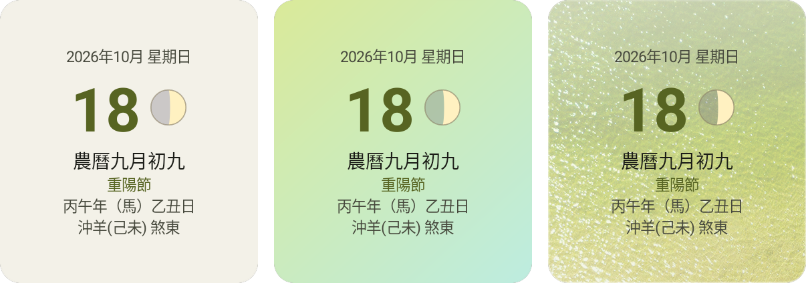
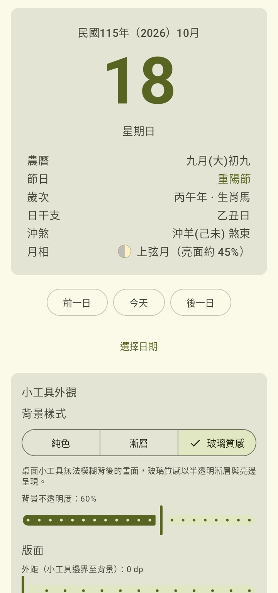
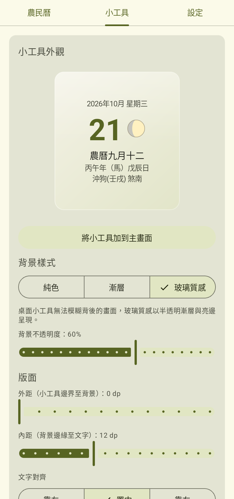
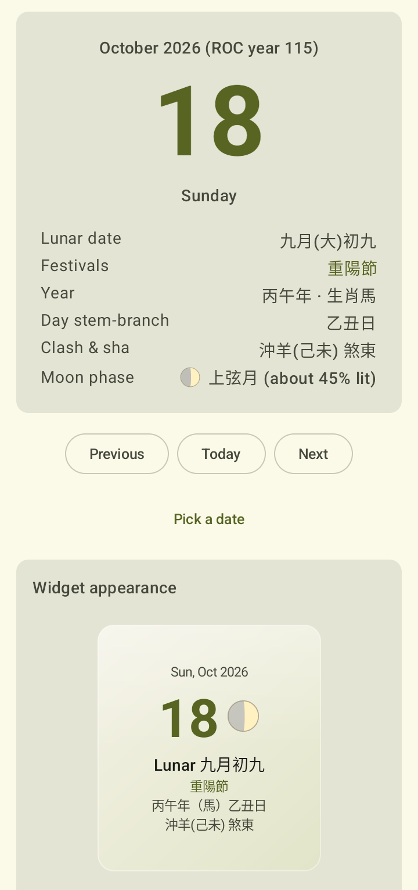
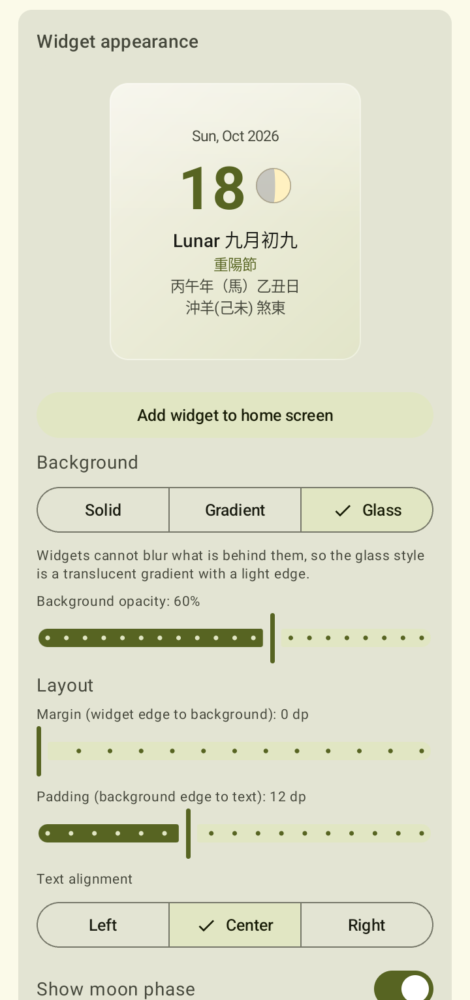

<p align="center"></p>

# Simple Tung Shing 簡易農民曆

A simple Tung Shing (農民曆／黃曆／通書) home-screen widget and companion app for Android.

一個簡單的 Android 農民曆（黃曆／通書）桌面小工具與隨附程式。

## Screenshots 螢幕截圖

The widget in its solid, gradient and glass styles, on 重陽節:

小工具的純色、漸層與玻璃質感樣式（重陽節當天）：

<p align="center"></p>

The app in 台灣漢語 and English: the Almanac tab with its month calendar, and the Widget tab with a live preview of the widget.

程式的台灣漢語與英文介面：附月曆的「農民曆」分頁，以及可即時預覽小工具的「小工具」分頁。

<p align="center">
  
  
  
  
</p>

## Download 下載

Download the latest APK from [GitHub Releases](https://github.com/hiroshiyui/SimpleTungShing/releases/latest). Pick `simpletungshing_v<version>-release.apk`; the `-debug.apk` is meant for testing. The app needs Android 8.0 or later. Android may ask you to allow installing apps from your browser or file manager the first time.

請您從 [GitHub Releases](https://github.com/hiroshiyui/SimpleTungShing/releases/latest) 下載最新的 APK，選擇 `simpletungshing_v<版本>-release.apk`；`-debug.apk` 供測試使用。本程式需要 Android 8.0 以上版本。首次安裝時，Android 可能會請您允許瀏覽器或檔案管理程式安裝應用程式。

Each APK comes with a GPG signature (`.asc`), made with signing subkey `D54140C87FC19931` of the key with fingerprint `37A4 5B21 B45E A42E BE6C E74C 9F35 3471 AF05 D276`. To verify a download:

每個 APK 都附有 GPG 簽章（`.asc`），由指紋為 `37A4 5B21 B45E A42E BE6C E74C 9F35 3471 AF05 D276` 之金鑰的簽署子金鑰 `D54140C87FC19931` 簽署。驗證方式如下：

```bash
gpg --recv-keys 37A45B21B45EA42EBE6CE74C9F353471AF05D276
# or: curl -s https://github.com/hiroshiyui.gpg | gpg --import
gpg --verify simpletungshing_v1.0.1-release.apk.asc simpletungshing_v1.0.1-release.apk
```

## Features 功能

- **Home-screen widget** showing today's Gregorian date and weekday, lunar date (including leap months), the year's sexagenary name and zodiac animal, the day's sexagenary stem-branch, and its clash and sha direction. The widget updates itself shortly after local midnight and when the system time or time zone changes. On smaller sizes, only the date lines are shown.
- **Customizable look**: choose a solid, gradient or glass-style background (following your wallpaper colors on Android 12+), adjust its transparency, margin, padding and text alignment, and show or hide the moon phase. Widgets cannot blur what is behind them, so the glass style is a translucent gradient with a light edge.
- **Solar terms** (節氣), such as 立春 and 霜降, shown on their day.
- **Festivals and observances** (節日) from the Han traditional and religious calendars, such as 春節, 清明節, 端午節, 中秋節 and 天后誕, shown on the widget and in the app.
- **Moon phase**, derived either from the lunar day (初一 as new moon) or by astronomical calculation; you pick the method.
- **Fortune, 宜忌 and 吉時** in the app: the day's 建除 value and 黃道／黑道 deity, the activities traditionally suited or unsuited to that 建除 value, and the auspicious double hours with their 干支 and clock span.
- **Companion app** for browsing any date in the dataset range, from a month calendar that marks each day's lunar date and solar term, by stepping day by day, or by picking a date. It also shows the ROC year and whether the lunar month is long or short. The widget's look is set on its own Widget tab, and the language on the Settings tab.
- **English and Taiwanese Mandarin (台灣漢語)** interfaces, following the system language by default; on Android 13+ you can also pick the language in the app. Almanac content stays in Han script (漢文).
- **Offline and private**: all data is bundled with the app. It has no internet permission, asks for no runtime permissions and collects nothing; the only permissions are the standard install-time ones WorkManager uses to update the widget.

- **桌面小工具**：顯示今日國曆日期、星期、農曆日期（含閏月）、歲次干支與生肖、日干支，以及沖煞。小工具會在當地午夜過後、系統時間或時區變更時自動更新；尺寸較小時僅顯示日期資訊。
- **自訂外觀**：可選擇純色、漸層或玻璃質感背景（Android 12 以上依桌布配色），調整背景透明度、外距、內距與文字對齊，並可顯示或隱藏月相。桌面小工具無法模糊背後的畫面，玻璃質感以半透明漸層與亮邊呈現。
- **節氣**：在節氣當天顯示名稱，例如立春、霜降。
- **節日**：在小工具與程式中顯示漢族傳統節日與宗教節日，例如春節、清明節、端午節、中秋節、天后誕等。
- **月相**：可選擇依農曆日期（以初一為新月）推估，或以天文公式計算。
- **吉凶、宜忌與吉時**：程式中顯示當天的建除十二神與黃道黑道十二神、該建除日傳統上宜做與忌做的事，以及吉時的時辰干支與時間。
- **隨附程式**：可從標示農曆日期與節氣的月曆點選、逐日切換或選擇日期，瀏覽資料範圍內任一天的農民曆資訊，並另外顯示民國年與農曆大小月。小工具外觀在「小工具」分頁設定，語言則在「設定」分頁。
- **介面支援英文與台灣漢語**：預設跟隨系統語言，Android 13 以上也可在程式中自行選擇。農民曆內容維持漢文。
- **離線、保護隱私**：所有資料皆隨程式內建，沒有網路權限，不要求任何執行階段權限，也不收集任何資料；僅帶有 WorkManager 更新小工具所需的標準安裝時權限。

## Data 資料

Solar–lunar date conversion comes from the Central Weather Administration (CWA) open dataset 「日曆資料-國農曆對照」 ([A-A0087-001](https://opendata.cwa.gov.tw/dataset/astronomy/A-A0087-001)), bundled unmodified. It covers **2022-01-01 to 2050-12-31**; dates outside this range show an out-of-range message.

The day's stem-branch (日干支), zodiac animal (生肖), clash (沖) and sha direction (煞) are **derived by the app** according to traditional rules, and the moon phase (月相) from the lunar day or an astronomical formula. Festival names and dates follow the Wikipedia article [漢族傳統節日](https://zh.wikipedia.org/zh-tw/漢族傳統節日), using the customary Taiwan date where it lists several; solar terms (節氣), and the festivals tied to them (清明, 冬至, 三伏), are computed by the app. They are not provided or endorsed by CWA. These items are presented as folk custom and tradition, not as fact or prediction.

The fortune (吉凶), suitable and unsuitable activities (宜忌) and auspicious hours (吉時) are also computed by the app, by the 建除十二神 and 黃道黑道十二神 rules of the《協紀辨方書》tradition: the solar month changes on each 節, the day's 建除 value and deity follow from the day branch, and the hour deities from the day branch with 五鼠遁 hour stems, dropping the hour that clashes with the day. The 宜忌 are the activities 通書 commonly attach to each 建除 value. This is a simplified reading without the full 神煞 tables that commercial almanacs add, so a published 農民曆 may differ.

國曆與農曆對照資料來自交通部中央氣象署開放資料「日曆資料-國農曆對照」（[A-A0087-001](https://opendata.cwa.gov.tw/dataset/astronomy/A-A0087-001)），原樣內建於程式中，涵蓋 **2022-01-01 至 2050-12-31**；超出範圍的日期會顯示提示訊息。

日干支、生肖、沖、煞由**本程式依傳統規則推算**，月相則依農曆日期或天文公式推算，皆非中央氣象署提供或認可。節日名稱與日期參考維基百科[「漢族傳統節日」](https://zh.wikipedia.org/zh-tw/漢族傳統節日)條目，列有多個日期者採臺灣習俗；節氣及與節氣相關的節日（清明、冬至、三伏）由本程式計算。吉凶、宜忌與吉時亦由本程式依《協紀辨方書》一系的建除十二神與黃道黑道十二神規則推算：月建以節氣切換，日的建除與十二神由日支推得，時辰的十二神則由日支起例並以五鼠遁推時干，並排除與日支相沖的時辰；宜忌為通書常見附於各建除日的事項。此為簡化規則，未納入市售農民曆另加的各種神煞，與市售農民曆可能不同。這些內容屬於民俗傳統，僅供參考，並非事實陳述或預測。

## Building 建置

Requirements: Android SDK (compile SDK 37). The Gradle daemon runs on JDK 25, which the foojay toolchain resolver downloads automatically if needed. The app supports Android 8.0 (API 26) and later.

需求：Android SDK（compile SDK 37）。Gradle daemon 使用 JDK 25，必要時 foojay toolchain resolver 會自動下載。程式支援 Android 8.0（API 26）以上版本。

```bash
./gradlew :app:assembleDebug        # Debug APK → app/build/outputs/apk/debug/
./gradlew :app:testDebugUnitTest    # JVM unit tests 單元測試
./gradlew :app:lintDebug            # Lint
```

## Attribution 資料來源標示

This app uses open data from the Central Weather Administration, Ministry of Transportation and Communications: 「日曆資料-國農曆對照」 (<https://opendata.cwa.gov.tw/dataset/astronomy/A-A0087-001>), used in accordance with the [CWA Open Data Platform data usage rules](https://opendata.cwa.gov.tw/about/rules). See [NOTICES.md](NOTICES.md) for all third-party notices.

本程式使用交通部中央氣象署開放資料「日曆資料-國農曆對照」（<https://opendata.cwa.gov.tw/dataset/astronomy/A-A0087-001>），依[中央氣象署開放資料平臺資料使用規範](https://opendata.cwa.gov.tw/about/rules)使用。完整第三方聲明請見 [NOTICES.md](NOTICES.md)。

## License 授權

Simple Tung Shing is free software, released under the [GNU General Public License, version 3 or later](LICENSE). The bundled CWA data and the Wikipedia festival list keep their own terms, as listed in [NOTICES.md](NOTICES.md).

簡易農民曆是自由軟體，以 [GNU 通用公共授權第 3 版或其後版本](LICENSE)釋出。隨附的中央氣象署資料與維基百科節日列表則各依其原本的使用條款，詳見 [NOTICES.md](NOTICES.md)。
